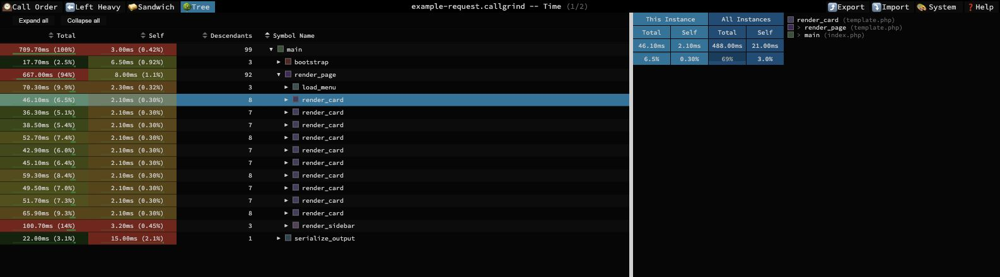
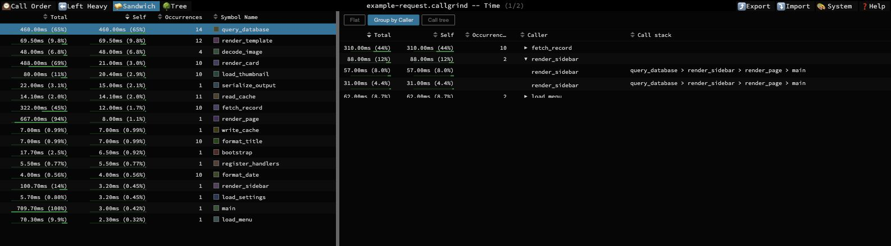
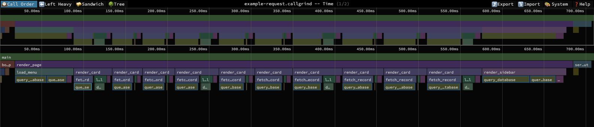

# speedscope-xdebug

An **Xdebug-only fork of [speedscope](https://github.com/jlfwong/speedscope)**,
focused on exploring PHP call trees and large profiles, including WordPress workloads.

> **Only Xdebug profiler output is supported by this fork.**
> Input files must contain Xdebug's per-invocation Callgrind records, typically
> named `cachegrind.out.*`. Aggregated Callgrind files from other producers are
> not supported. For other profilers and languages, use the original
> [speedscope project](https://github.com/jlfwong/speedscope).

This fork builds on the work of **Jamie Wong and the speedscope contributors**.
The original project provides the viewer, rendering engine, and foundation for
these changes. See [Credits and license](#credits-and-license).

## Main changes from upstream

| Area                      | Changes in this fork                                                                                                                                                                         |
| ------------------------- | -------------------------------------------------------------------------------------------------------------------------------------------------------------------------------------------- |
| Xdebug import             | Reconstructs individual calls and their calling contexts from Xdebug's post-order records, with separate time and memory profiles. Replaces the generic Callgrind call-graph reconstruction. |
| Tree view                 | Adds an expandable call tree with self/total costs, sortable descendant counts, search, and branch heat colors.                                                                              |
| Function occurrences      | Extends Sandwich view with individual occurrences, **Flat**, **Group by Caller**, and **Call tree** modes. Includes occurrence counts and navigation to a specific call in Tree view.        |
| Investigation interface   | Adds resizable panes and table columns, and fixes scrolling and virtualization issues when exploring large call lists.                                                                       |
| Large-profile performance | Uses compact typed-array records and finalizes each call once during import. Adds viewport-based flamechart detail filtering to reduce rendering work.                                       |
| Cost display              | Improves time and memory formatting, axis precision at high zoom, and the distinction between one occurrence and all occurrences of a function.                                              |
| MCP analysis              | Adds a local Model Context Protocol server for function searches, caller analysis, call-tree navigation, and inspection of expensive occurrences.                                            |
| Reusable workflow         | Includes the **Profile with Speedscope** skill and a batch runner that saves MCP analysis results for before/after and cold/warm comparisons.                                                |

### Xdebug is the supported scope

The Callgrind importer expects Xdebug's completed calls before their callers and
preserves individual occurrences rather than distributing an aggregated call graph.
Files from a declared non-Xdebug producer are rejected by that importer.

Some inherited importers remain in the source tree, but compatibility with other
profilers is outside this fork's supported scope. The multi-format guarantees and
import guides of upstream speedscope do not apply to this fork.

## Screenshots

All screenshots use a [fully synthetic example profile](sample/profiles/callgrind/example-request.callgrind).
Function names, file names, and costs are invented. No customer or application
profile was used to create these images. Open the example file in the viewer to
explore the same data.

**Tree:** compare individual calls, descendant counts, and the selected call's
costs against all occurrences of its function.



**Sandwich:** group a function's occurrences by caller, then expand a group to
inspect individual costs and call stacks.



**Call Order:** explore the hierarchy reconstructed from Xdebug costs. Positions
on this axis are not recorded timestamps.



## Run locally

Use Node.js 20 or newer and install from this fork's source:

```sh
git clone https://github.com/cb-digital-lab/speedscope-xdebug.git
cd speedscope-xdebug
npm install
npm run serve
```

Open the local URL printed in the terminal, then browse for an Xdebug profile or
drag and drop it onto the page. Files opened this way are parsed in the browser;
they are not uploaded to an analysis server. Use the profile selector to switch
between time and memory when both metrics are available.

To create a standalone browser build:

```sh
npm run prepack
```

Open `dist/release/index.html` in Chrome or Firefox. For very large profiles,
prefer opening the file directly in the viewer over passing it through the CLI.

## Explore a profile

- **Call Order** shows the hierarchy and positions reconstructed from Xdebug
  costs. These positions are not recorded timestamps.
- **Left Heavy** groups identical stacks to highlight the most expensive branches.
- **Sandwich** starts from a function and lets you investigate its individual
  occurrences, group them by caller, or explore their call paths.
- **Tree** exposes the reconstructed hierarchy as an expandable table. Compare
  self and total costs, sort by descendants, and inspect a selected occurrence's
  stack and its function's overall statistics.

Click a frame to inspect it, double-click a flamechart frame to zoom, and use
`Cmd+F` / `Ctrl+F` to search. Drag pane dividers and column boundaries to adjust
an investigation's layout.

## Analyze through MCP

The local MCP server loads an Xdebug profile once and exposes bounded queries over
its time and memory metrics. It uses the same importer and profile model as the
browser viewer.

From the repository directory:

```sh
node --import tsx scripts/mcp-server.ts --profiles-dir /path/to/profiles
```

This is a **STDIO** server for an MCP client, not an HTTP endpoint. It does not
call an AI model itself; the client controls which results are shared with one.
File access is restricted to the configured profiles directory.

A typical investigation uses:

1. `list_profiles` to find a file.
2. `load_profile` to load it and obtain the current `datasetId` and metric indices.
3. `find_functions` to rank functions by self cost, total cost, or occurrence count.
4. `function_callers` and `function_invocations` to identify expensive calling contexts.
5. `node_details` and `call_tree` to inspect an occurrence and drill into its children.

Loading another file replaces the active dataset. Use its new identifiers and
paths for subsequent queries.

See [MCP setup and reference](docs/mcp.md) for client configuration and tool semantics.
The [Profile with Speedscope skill](skills/profile-with-speedscope/SKILL.md) adds a
repeatable investigation and measurement workflow. Its
[batch runner](skills/profile-with-speedscope/scripts/profile-suite.mjs) can save
analysis results as JSON:

```sh
node skills/profile-with-speedscope/scripts/profile-suite.mjs --help
```

## Reading the results correctly

- **Total** includes child calls; **Self** excludes them. Inclusive costs overlap,
  so adding nested or recursive function totals causes double counting.
- **Call Order is reconstructed.** Xdebug does not provide real call timestamps
  or the distribution of self work before and between child calls.
- **Xdebug adds overhead.** Use profiles to locate work, and comparable requests
  without profiling to establish an optimization's actual effect on latency.
- **Memory costs are not peak memory.** They are reconstructed cumulative costs,
  not PHP's peak allocation or the RAM used by the viewer or MCP server.
- **Profiles do not contain SQL arguments, exact hook names, or cache hit rates.**
  Establish those through separate targeted observations when needed.

## Import benchmark

One local comparison used a 398 MB Xdebug file with 5,552,009 occurrences per
metric, running both versions in separate Node.js 26.11.1 processes without a CPU
profiler:

| Measurement                   | Before import optimization | After import optimization |
| ----------------------------- | -------------------------: | ------------------------: |
| Parsing                       |                    18.97 s |                   11.88 s |
| Resident memory after parsing |                  4,785 MiB |                 3,911 MiB |

Complete frame and call-tree checksums matched for both metrics. These figures
measure the Node importer, not browser rendering or PHP request latency; results
will vary by profile and machine.

To measure another file and verify its output:

```sh
npm run benchmark:callgrind -- /path/to/cachegrind.out.example --verify
```

## Development

```sh
npm test
```

This runs type checking, lint, the test suite with coverage, and schema generation.

## Credits and license

**Original project:** [jlfwong/speedscope](https://github.com/jlfwong/speedscope),
created by **Jamie Wong**, with contributions from the speedscope community.

**This fork:** [cb-digital-lab/speedscope-xdebug](https://github.com/cb-digital-lab/speedscope-xdebug),
with changes focused on Xdebug profiling and investigation workflows.

The project retains the **MIT license**. The original copyright notice and license
are preserved in [LICENSE](LICENSE).
